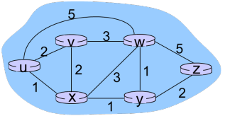
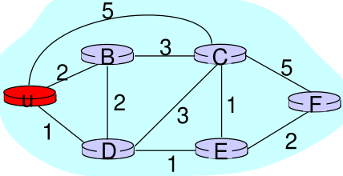

1. link state algorithm

- all routers have complete topology, link cost info
- each router knows neighbor's information at first
- uses flooding to propagate neighbor information to whole network

2. link state demonstration with Dijkstra's algorithm
- initialize


| step | N | D(B), p(B) | D(C), p(C) | D(D), p(D) | D(E), p(E) | D(F), p(F) |
| --- | --- | --- | --- | --- | --- | --- |
| 0 | u | 2, u | 5, u | 1, u | inf | inf |
| 1 |  |  |  |  |  |  |
| 2 |  |  |  |  |  |  |
| 3 |  |  |  |  |  |  |
| 4 |  |  |  |  |  |  |
| 5 |  |  |  |  |  |  |


- D(D) is smallest out of all D(x); add D to N

| step | N | D(B), p(B) | D(C), p(C) | D(D), p(D) | D(E), p(E) | D(F), p(F) |
| --- | --- | --- | --- | --- | --- | --- |
| 0 | u | 2, u | 5, u | 1, u | inf | inf |
| 1 | uD |  |  |  |  |  |
| 2 |  |  |  |  |  |  |
| 3 |  |  |  |  |  |  |
| 4 |  |  |  |  |  |  |
| 5 |  |  |  |  |  |  |


- update all D() and p()

| step | N | D(B), p(B) | D(C), p(C) | D(D), p(D) | D(E), p(E) | D(F), p(F) |
| --- | --- | --- | --- | --- | --- | --- |
| 0 | u | 2, u | 5, u | 1, u | inf | inf |
| 1 | uD | 2, u | 4, D |  | 2, D | inf |
| 2 |  |  |  |  |  |  |
| 3 |  |  |  |  |  |  |
| 4 |  |  |  |  |  |  |
| 5 |  |  |  |  |  |  |


- D(E) is smallest out of all D(x); add E to N

| step | N | D(B), p(B) | D(C), p(C) | D(D), p(D) | D(E), p(E) | D(F), p(F) |
| --- | --- | --- | --- | --- | --- | --- |
| 0 | u | 2, u | 5, u | 1, u | inf | inf |
| 1 | uD | 2, u | 4, D |  | 2, D | inf |
| 2 | uDE |  |  |  |  |  |
| 3 |  |  |  |  |  |  |
| 4 |  |  |  |  |  |  |
| 5 |  |  |  |  |  |  |


- update all D() and p()

| step | N | D(B), p(B) | D(C), p(C) | D(D), p(D) | D(E), p(E) | D(F), p(F) |
| --- | --- | --- | --- | --- | --- | --- |
| 0 | u | 2, u | 5, u | 1, u | inf | inf |
| 1 | uD | 2, u | 4, D |  | 2, D | inf |
| 2 | uDE | 2, u | 3, E |  |  | 4, E |
| 3 |  |  |  |  |  |  |
| 4 |  |  |  |  |  |  |
| 5 |  |  |  |  |  |  |


- D(B) is smallest out of D(x); add B to N

| step | N | D(B), p(B) | D(C), p(C) | D(D), p(D) | D(E), p(E) | D(F), p(F) |
| --- | --- | --- | --- | --- | --- | --- |
| 0 | u | 2, u | 5, u | 1, u | inf | inf |
| 1 | uD | 2, u | 4, D |  | 2, D | inf |
| 2 | uDE | 2, u | 3, E |  |  | 4, E |
| 3 | uDEB |  |  |  |  |  |
| 4 |  |  |  |  |  |  |
| 5 |  |  |  |  |  |  |


- update all D() and p()

| step | N | D(B), p(B) | D(C), p(C) | D(D), p(D) | D(E), p(E) | D(F), p(F) |
| --- | --- | --- | --- | --- | --- | --- |
| 0 | u | 2, u | 5, u | 1, u | inf | inf |
| 1 | uD | 2, u | 4, D |  | 2, D | inf |
| 2 | uDE | 2, u | 3, E |  |  | 4, E |
| 3 | uDEB |  | 3, E |  |  | 4, E |
| 4 |  |  |  |  |  |  |
| 5 |  |  |  |  |  |  |


- D(C) is smallest of D(x); add C to N

| step | N | D(B), p(B) | D(C), p(C) | D(D), p(D) | D(E), p(E) | D(F), p(F) |
| --- | --- | --- | --- | --- | --- | --- |
| 0 | u | 2, u | 5, u | 1, u | inf | inf |
| 1 | uD | 2, u | 4, D |  | 2, D | inf |
| 2 | uDE | 2, u | 3, E |  |  | 4, E |
| 3 | uDEB |  | 3, E |  |  | 4, E |
| 4 | uDEBC |  |  |  |  |  |
| 5 |  |  |  |  |  |  |


- update all D() and p()

| step | N | D(B), p(B) | D(C), p(C) | D(D), p(D) | D(E), p(E) | D(F), p(F) |
| --- | --- | --- | --- | --- | --- | --- |
| 0 | u | 2, u | 5, u | 1, u | inf | inf |
| 1 | uD | 2, u | 4, D |  | 2, D | inf |
| 2 | uDE | 2, u | 3, E |  |  | 4, E |
| 3 | uDEB |  | 3, E |  |  | 4, E |
| 4 | uDEBC |  |  |  |  | 4, E |
| 5 |  |  |  |  |  |  |


- add last remaining F to N

| step | N | D(B), p(B) | D(C), p(C) | D(D), p(D) | D(E), p(E) | D(F), p(F) |
| --- | --- | --- | --- | --- | --- | --- |
| 0 | u | 2, u | 5, u | 1, u | inf | inf |
| 1 | uD | 2, u | 4, D |  | 2, D | inf |
| 2 | uDE | 2, u | 3, E |  |  | 4, E |
| 3 | uDEB |  | 3, E |  |  | 4, E |
| 4 | uDEBC |  |  |  |  | 4, E |
| 5 | uDEBCF |  |  |  |  |  |


-  forwarding table

| destination | link |
| --- | --- |
| B | (u,B) |
| C | (u,D) |
| D | (u,D) |
| E | (u,D) |
| F | (u,D) |


3. Dijkstra's algorithm pseudo code

```plain-text
Initialization:
	N’ = {u};
	for all nodes v
		if v adjacent to u
			then D(v) = c(u,v);
		else D(v) = ∞ ;

Loop
	find w not in N’ such that D(w) is a minimum;
	add w to N’;
	update D(v) for all v adjacent to w and not in N’ :
		if D(w) + c(w,v) < D(v) then
			D(v) = D(w) + c(w,v); p(v) = w;
	until N’ = N;
```


4. Dijkstra's algorithm
- n(n+1)/2 comparisons; O(n^2^)
- efficient implementations with heap DS: O(nlogn)

reference: 
- Gachon University Computer Network class material
- Computer Networking: A Top Down Approach 