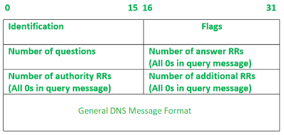
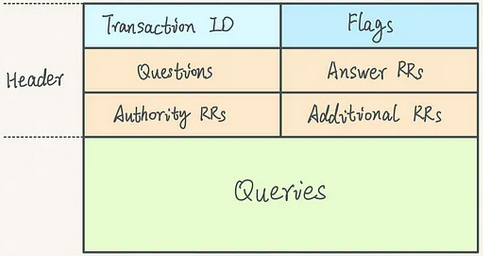
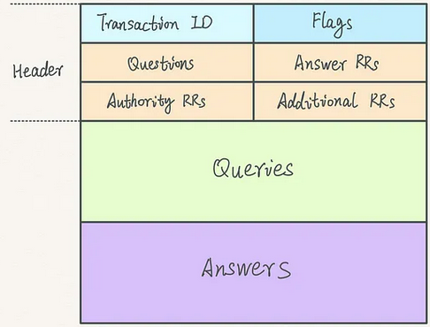

## 1. Identification
used to match the response with the query

## 2. Flags

| QR | Opcode | AA | TC | RD | RA | zero | rCode |
| --- | --- | --- | --- | --- | --- | --- | --- |
| 1 | 4 | 1 | 1 | 1 | 1 | 3 | 4 |

- QR (query/response)
value 0: the message is a query request
value 1: the message is a response

- opcode
defines the type of a query carried by a message. Value repeated in the response
   - value 0: standard query
   - value 1: inverse of query; IP address -> domain name
   - value 2: server status request
   - value 4: notify
   - value 5: update
   - value 6: DNS Stateful Operations

- AA (Authoritative Answer)
value 1: authoritative server
value 0: non-authoritative

- TC (Truncation)
specifies if the length exceeds the allowed length of 512 bytes, allowed length for UDP datagrams

- RD (Recursion Desired)
value 1: server needs to answer recursively
value copied to response message

- RA (Recursion Available)
specifies the availability of recursive response

- Zero
reserved field set to 0

- rCode (Response Code)
denotes whether query was answered successfully
   - 0: no error
   - 1: problem with format specification
   - 2: server failure
   - 3: name given doesn't exist in domain
   - 4: request type not supported by server
   - 5: nonexecution due to policy reasons
   - etc^(2)^

## 3. Number of Questions
specify the number of questions in the question section

present in both the query request and response

## 4. Number of answer RRs
specifies the number of answers in the answer section

0s in query message

## 5. Number of authority RRs
number of the resource records in the authoritative section

0s in query message

## 6. Number of additional RRs
number of additional RRs in the addtional section

usually 0s in query message

## 7. DNS query

Header + Query section + (Additional Records)

## 8. DNS response

Header + Query section + Answer section + Authority section + Additional Records

---
reference:
(1): <https://www.geeksforgeeks.org/dns-message-format/>
(2): <https://www.iana.org/assignments/dns-parameters/dns-parameters.xhtml#dns-parameters-5>
(3): <http://www.ktword.co.kr/test/view/view.php?no=2251>
(4): <https://cabulous.medium.com/dns-message-how-to-read-query-and-response-message-cfebcb4fe817>