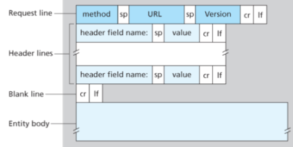
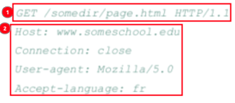
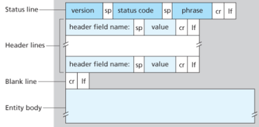
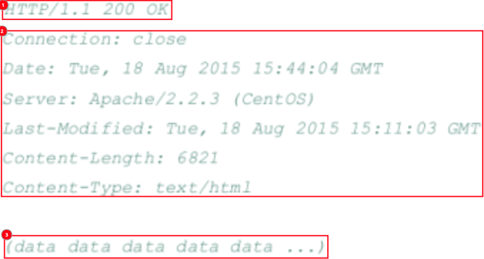

1. HTTP
- application layer protocol
- uses TCP as transport protocol
- HTTP server maintains no information about the clients => stateless protocol

2. HTTP request message

(1): request line
- method
   - GET: request object
   - POST: contains user input in the entity body
   - HEAD: like GET but doesn't receive object
   - PUT: upload object
   - DELETE: delete object
- URL
- HTTP version
(2): header line

3. HTTP response message

(1): status line
- protocol version
- status code/message
   - 200 OK: request success
   - 301 Moved Permanently: new URL specified in Location header of response
   - 400 Bad Request: request was not understood
   - 404 Not Found
   - 505 HTTP Version Not Supported
(2): header line
(3): entity body

4. HTTPS
- secure version of HTTP using SSL/TLS certificates
- protects sensitive information via encryption

5. ports used
- HTTP: TCP port 80
- HTTPS: TCP port 443

reference:
- Computer Networking: A Top-Down Approach