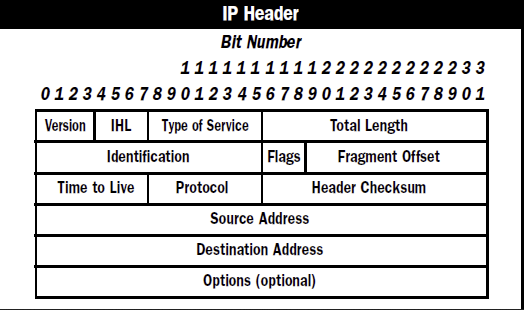

version: 
- only IPv4 uses this field => always will be 4

header length:
- length of IP header in 32-bit words
- 5 ~ 15

type of service:

total length:
- header + data length in bytes
- 20 ~ 65,535

identification:
- id

IP flags:
- 3 bits used for fragmentation
   - first bit 0
   - Don't fragment(DF): second bit indicates packet should not be fragmented
   - More Fragments(MF): third bit is set on all fragmented packets but the last one

fragment offset:
- position of the fragment in original ip packet

time to live:
- decremented by 1 for each router passed

protocol:
- indicates protocol of payload
- TCP is 6, UDP is 17

header checksum:

source address:

destination address:

IP option: