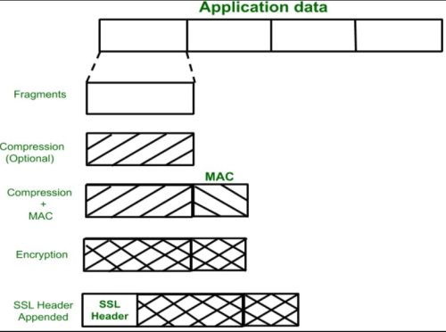

1. SSL record protocol
- protocol for sending data
- divide data into fragments and compress
- append Message Authentication Code (MAC) generated with hashing algorithms
- encrypt
- append SSL header
- SSL record provides:
   - confidentiality
   - message integrity

references:
- geeks for geeks - SSL: <https://www.geeksforgeeks.org/computer-networks/secure-socket-layer-ssl/>