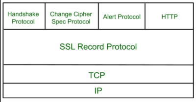

1. SSL/TLS
- Secure Sockets Layer (SSL) is an older version of Transport Layer Security (TLS)
- provides:
   - encryption
   - authentication
   - data integrity

2. SSL protocols
- SSL Record protocol
- handshake protocol
- change-cipher spec protocol
- alert protocol

3. SSL certificate
- digital certificate used to secure and verify identity of website or service
- issued by trusted third-party called Certificate Authority (CA)
- important characteristics that make it reliable:
   - encryption
   - authentication
   - integrity
   - non-repudiation: recipient can't deny having received it
   - public-key cryptography
   - session management: can resume session without establishing a new connection
   - certificates issued by trusted CAs: high level of trust

4. types of SSL certificates
- single-domain SSL certificate
   - covers one domain
- wildcard SSL certificate
   - covers subdomains as well
- multi-domain SSL certificate
   - covers multiple domains

5. SSL validation level
- domain validation
   - requires proof of owning domain
- organization validation
   - CA contacts organization to confirm identity
   - provides more assurance to users about the legitimacy 
- extended validation
   - requires comprehensive background check
   - highest level of trustworthiness

reference:
- geeks for geeks - SSL: <https://www.geeksforgeeks.org/computer-networks/secure-socket-layer-ssl/>