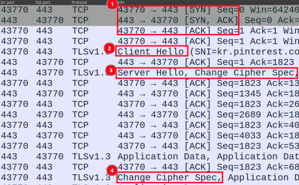

TLS 1.3 handshake:

[1]: TCP handshake
[2]: TLS handshake - client hello
[3]: TLS handshake - server parameters, server authentication
[4]: TLS handshake - client authentication

[TLS 1.3 handshake.pcapng](<TLS 1.3 handshake.pcapng>)