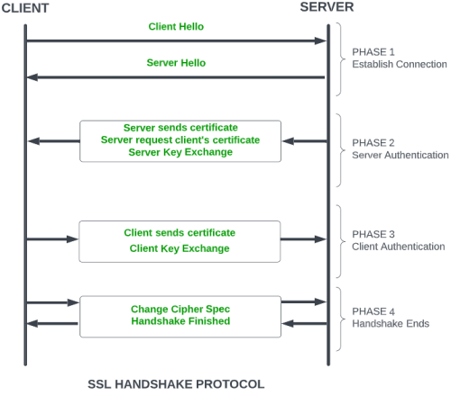
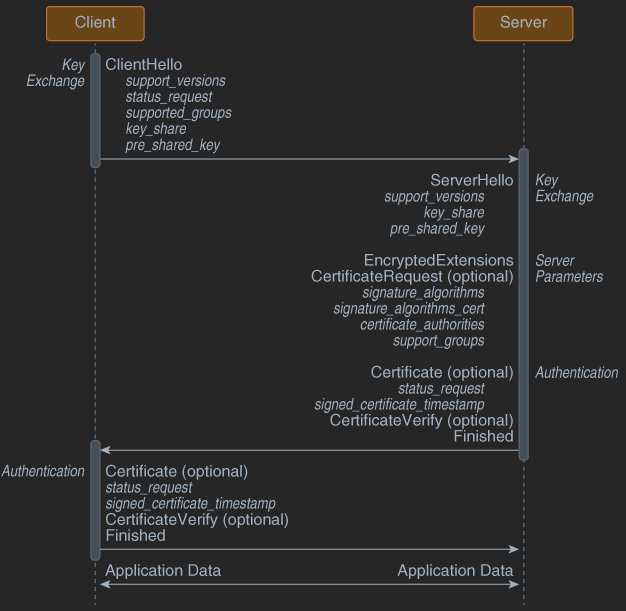

1. TLS 1.2 handshake protocol
- phase 1
   - client and server send hello-packets
   - cipher suite and protocol versions are exchanged
- phase 2
   - server sends certificate and server-key-exchange
   - ends by sending server-hello-end packet
- phase 3
   - client replies with certificate and client-exchange-key
- phase 4
   - change cipher spec occurs

2. TLS 1.3 handshake protocol
- key exchange
   - ClientHello
   - ServerHello
- server parameters
   - EncryptedExtensions: responses to ClientHello extensions not required to determine cryptographic parameters
   - CertificateRequest(optional): sent if certificate-based client authentication is desired
- authentication
   - Certificate(optional): authentication certificate or raw key
   - CertificateVerify(optional): signature over handshake using private key corresponding to public key in Certificate
   - Finished: MAC over entire handshake

reference: 
- geeks for geeks - SSL: <https://www.geeksforgeeks.org/computer-networks/secure-socket-layer-ssl/>
- IBM - TLS 1.3 protocol: <https://www.ibm.com/docs/en/sdk-java-technology/8?topic=handshake-tls-13-protocol>