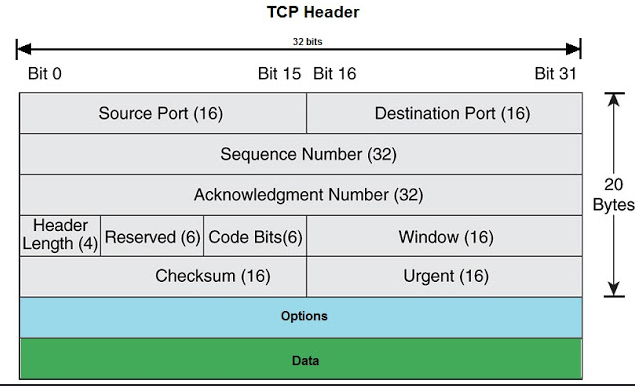

source port:

destination port:

sequence number:
- used for synchronizing source and destination

acknowledgement number:
- used for synchronizing source and destination

data offset(do):
- offset of data in 32-bit words

RSV:
- reserved, always set to 0

flags:
- ack: acknowledgement
- rst: reset connection
- syn: for initial handshake
- fin: end connection
- psh: tells application data should be transmitted immediately

window:
- receive window

checksum:

urgent pointer:

options:

reference:
- <https://www.networkurge.com/2017/10/tcp-header-details.html>