# Different search techniques in branch and bound
## 1. LC search (Least Cost search)
Uses a heuristic cost function to compute the bound values at each node. Nodes are added to the list of live nodes as soon as they get generated.

The node with the least value of a cost function is selected as next E-node

## 2. BFS (Breadth First search)
Also known as FIFO search.

Maintains a list of live nodes in a queue. The live nodes are searched in the FIFO order to make them next E-nodes

## 3. DFS (Depth First search)
Also known as LIFO search.

Maintains the list of live nodes in a stack. The live nodes are searched in a LIFO order to make them next E-nodes

# When to apply Branch and Bound algorithm
- it is appropriate to use a branch and bound approach if the given problem is discrete optimization, refering to problems in which the variables belong to the discrete set. Examples of such problems include 0-1 integer programming and network flow problems

- when it comes to combinatory optimization problems, which are optimized by finding its max or min based on its objective function. Examples include boolean satisfiability and integer linear programming

# Basic concepts of B&B
## • Generation of a state space tree:
B&B generates a state space tree to efficiently search the solution space of a given problem instance.

All children of an E-node in a state space tree are produced before any live node gets converted into an E-node, thus, the E-node remains an E-node until it becomes a dead node

## • Evaluation of a candidate solution:
Unlike backtracking, B&B need additional factors to evaluate a candidate solution:
(1) A way to assign a bound on the best values of the given criterion functions to each node in a state space tree. It is produced by the addition of further components to the partial solution given by that node
(2) The best values of a given criterion function obtained so far. It describes the upper bound for the maximizaton problem and the lower bound for the minimization problem

A feasible solution is defined by the problem states that satisfy all the given constraints. An optimal solution is a feasible solution, which produces the best value of a given objective function. 

## • Bounding function
Optimizes the search for a solution vector in the solution space of a given problem instance

A heuristic function that evaluates the lower and upper bounds on the possible solutions at each node. The bound values are used to search the partial solutions leading to an optimal solution. If a node does not produce a solution better than the best solution obtained thus far, it is abandoned without further exploration

## • Reasons to dismiss a search path at the current node
(1) The bound value of the node is lower(higher) than the upper(lower) bound in the case of the maximization(minimization) problem
(2) The node represents infeasible solutions
(3) The node represents a subset of a feasible solution containing a single point. If the latest solution is better than the best solution obtained so far, the best solution is modified

# Types of B&B solutions:
## • variable size solution
Using this solution, we can find the subset of the given set that gives the optimized solution to the given problem. 

For example, if we have to select a combination of elements from {A, B, C, D} that optimizes the given problem, and it is found that A and B together give the best solution, the solution will be {A, B}

## • fixed size solution
There are 0s and 1s in this solution, with the digit at the ith position indicating whether the ith element should be included. 

For the example above, the solution will be given by {1, 1, 0, 0}, 1 representing selection and 0 not

# Classification of B&B problems:
The B&B method can be classified into 3 types based on the order in which the state space tree is searched.

To denote the solutions in these methods, we will use the variable solution method

## 1. FIFO B&B
This is an approach that uses the queue approach to create a state-space tree

The breadth-first search is performed. 

For a given set {A, B, C, D}, the state space tree will be constructed as follows:
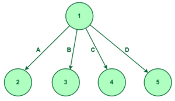
We first consider element A, then B, C, and D

Once the first level is completed, we'll consider the first element, node 2. It can have 3 children, the ones after A:
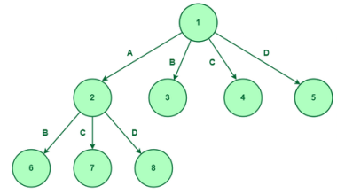

Now we expand node 3. As we have considered element B and not A, we have 2 options to explore:
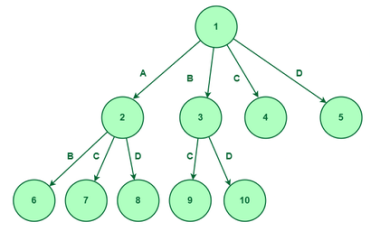

Next expand node 4:

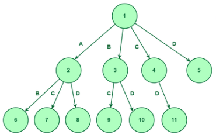

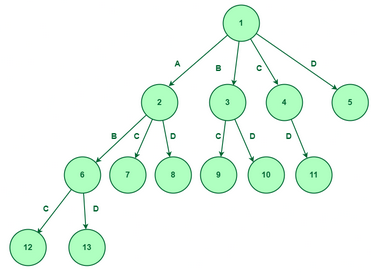

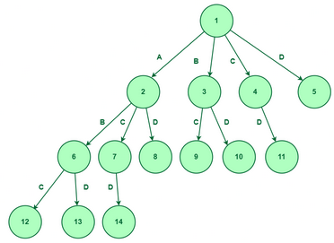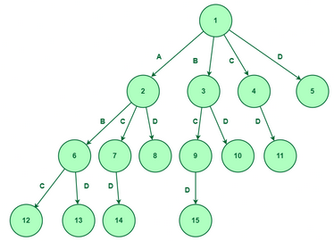## 2. LIFO B&B
This approach uses stack in creating the state space tree.

For a given set {A, B, C, D}, the state space tree will be constructed as follows:
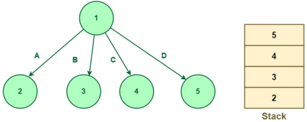

Pop node 5 off the stack. But node 5 is the last element, D, so there is no further scope for expansion.

Pop node 4 off the stack and expand:
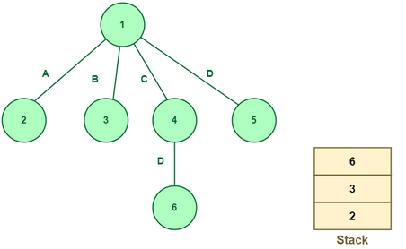

Pop node 6. Then pop node 3:

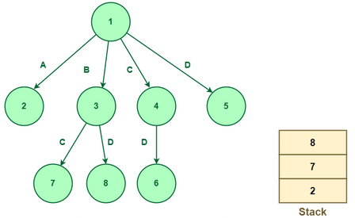
...

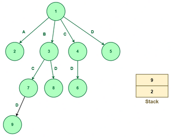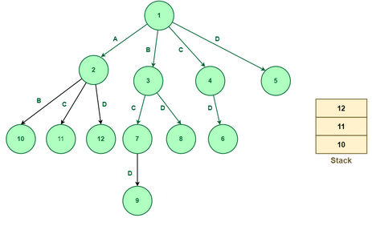## 3. Least Cost-B&B
This method uses the cost function. The previous 2 methods also calculate the cost function at each node but the cost is not being used for further exploration

The cost of the node can be defined using the problem

Consider a node whose cost has been determined. If this value is greater than U0, this node or its children will not be able to give a solution. Thus, we can kill this node, saving time

Let's first consider node 1 having ost infinity shown below:
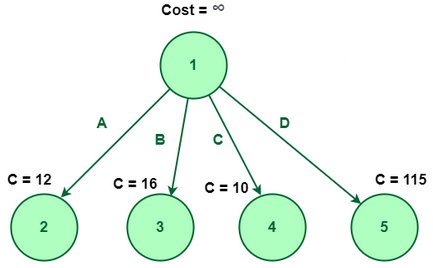
(Assume the costs of nodes 2, 3, 4, and 5)

We will explore the node with the least cost, which is node 4:
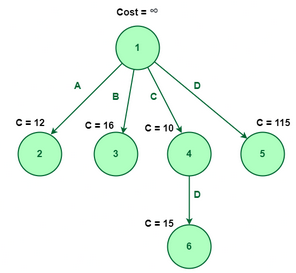

Node 6 has no element left to explore, making the element {C, D} the optimal way to choose the least cost.

---
reference:
<https://www.geeksforgeeks.org/introduction-to-branch-and-bound-data-structures-and-algorithms-tutorial/>