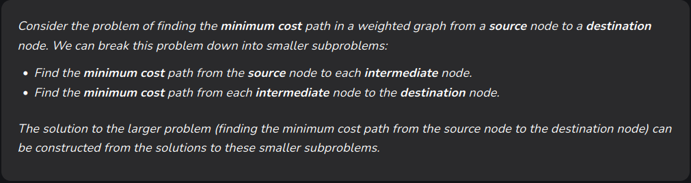
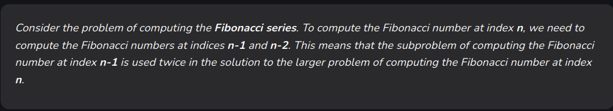

# - What is dynamic programming?(1)
A method used to solve complex problems by breaking them down into simpler subproblems.
By solving each subproblem only once and storing the results, it avoids redundant computations, leading to more efficient solutions for a wide range of problems

# - Dynamic programming steps(1)
## • Identify subproblem
Divide the main problem into smaller independent subproblems
## • Store Solutions
Solve each subproblem and store the solution in a table or array
## • Build up solutions
Use the stored solutions to build up the solution to the main problem

# - Examples(1)
- Fibonacci series
- Longest common subsequence
- Shortest path in a graph
- Knapsack problem

# - When to use DP(1)
## 1. Optimal substructure
We can combine the optimal results of subproblems to achieve the optimal result

## 2. Overlapping subproblems
The same subproblems are solved repeatedly in different parts of the problem

# - Approaches of DP(1)
## 1. Top-Down approach (Memoization)
We start with the final solution and recursively break it down into smaller subproblems. It's suitable when the number of subproblems is large and many of them are reused

## 2. Bottom-Up approach (Tabulation)
We start with the smallest subproblems and gradually build up to the final solution. Suitable when the number of subproblems is small and the optimal solution can be directly computed from the solutions to the smaller subproblems

# - DP algorithms(1)
## Common algorithms that use DP:
- Longest common subsequence: finds the longest common subsequence between two strings
- Shortest path in graph: Finds the shortest path between two nodes in a graph
- Knapsack problem: Determines the maximum value of items that can be placed in a knapsack with a given capacity
[Knapsack problem](<Study Notes/programming language study notes/Algorithms/Dynamic Programming/Knapsack problem.md>)
- Matrix chain multiplication: Optimizes the order of matrix multiplication to minimize the number of operations
- Fibonacci sequence: Calculates the nth Fibonacci number

# - Advantages of DP(1)
- Avoids redundant calculations
- Ensures the optimal solution is found by considering all possible combinations
- Breaks down problems into smaller manageable subproblems

# - Applications of DP(1)
- Optimization
- Computer science
- Operations research

---
reference:
(1) <https://www.geeksforgeeks.org/dynamic-programming/>