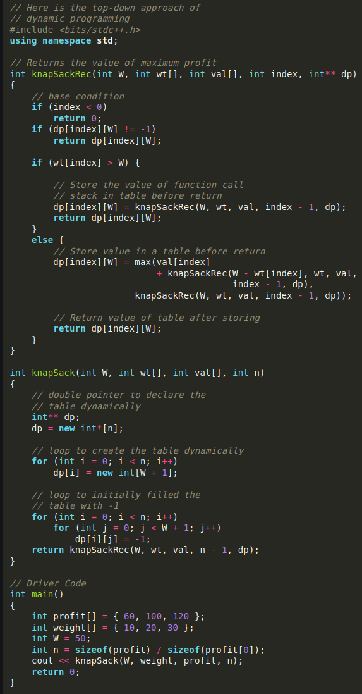
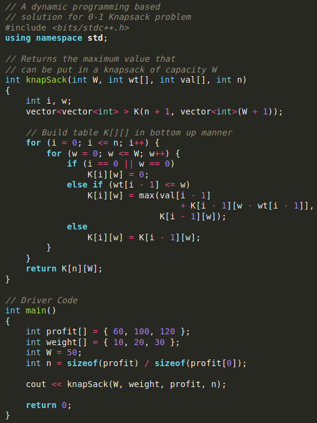
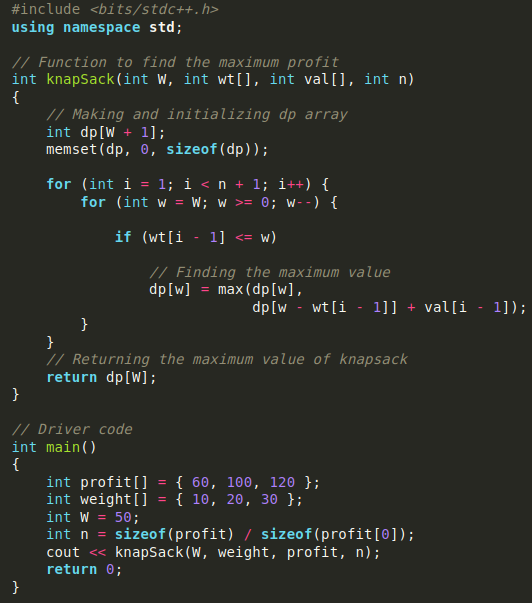

# 1. Definition(1)
Given N items where each item has some weight and value associated with it and also a bag with capacity W. 

# 2. Pseudo code(1)
## - DP top-down approach:
main:
get profit[], weight[], maxWeight, elementCount

print knapsack(maxWeight, weight[], profit[], elementCount)

---
knapsack(maxWeight, weight[], profit[], elementCount):
for i = 0~elementCount-1
	for j=0~maxWeight
		table[i][j] = -1
		
return recursiveKnapsack(maxWeight, weight[], profit[], elementCount-1, table[][])

---
recursiveKnapsack(maxWeight, weight[], profit[], index, table[][]):
if table[index][maxWeight] == -1
	if weight[index] > maxWeight
		table[index][maxWeight] = recursiveKnapsack(maxWeight, weight[], profit[], index-1, table[][])
	else
		table[index][maxWeight] = max(profit[index] + recursiveKnapsack(maxWeight-weight[index], weight[], profit[], index-1, table[][]), recursiveKnapsack(maxWeight, weight[], profit[], index-1, table[][]))

return table[index][maxWeight]

Time complexity: O(N*W)
Auxiliary Space: O(N*W) + O(N). The use of a 2D array data structure for storing intermediate states and O(N) auxiliary stack space has been used for recursion stack

## - Bottom-up approach:
main:
get profit[], weight[], maxWeight, elementCount

print knapsack(maxWeight, weight[], profit[], elementCount)

---
knapsack(maxWeight, weight[], profit[], elementCount):
for i = 0~elementCount
	for w = 0~maxWeight
		if i == 0 or w == 0
			profitTable[i][w] = 0
		else if weight[i-1] <= w 		# if the weight of the ith(since weight starts with index 0 i-1 is used) item is bigger than the current weight used
			profitTable[i][w] = max(profit[i-1] + profitTable[i-1][w - weight[i-1]], profitTable[i-1, w])
		else
			profitTable[i][w] = profitTable[i-1][w]

return profitTable[elementCount][maxWeight]

profitTable[i][w] is the best value you can achieve with the first i items using w weight

Time Complexity: O(N*W)
Auxiliary Space: O(N*W)

## - Space optimized approach:
We can use just 1 row instead of multiple rows if we traverse the rows from right to left

main:
get profit[], weight[], maxWeight, elementCount

print knapsack(maxWeight, weight[], profit[], elementCount)

---
knapsack(maxWeight, weight[], profit[], elementCount):
for i = 1~elementCount
	for w = maxWeight~0
		if weight[i-1]<=w
			dp[w] = max(profit[i-1] + dp[w-weight[i-1]], dp[w])		#Because this is before dp[w] is updated, these are from the previous item, not the current item. So this line compares the profits of the current item added to the profits up until the previous item using 'w - the current item's weight' with the profit up until the previous item using w weight

return dp[maxWeight]

Time Complexity: O(N*W)
Auxiliary Space: O(W)

---
reference: 
(1) <https://www.geeksforgeeks.org/0-1-knapsack-problem-dp-10/>