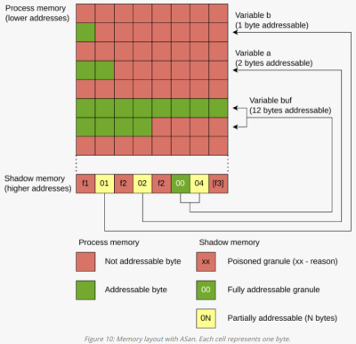

- memory regions inserted into the process memory, and so reflected in shadow memory
- act as buffer zones, separating different objects in memory with poisoned memory
- compiling with ASan changes memory layout


```c
int main() {
    volatile short buf[6], a=0;
    volatile char b=1;
    // trigger out-of-bounds so ASan shows
    // shadow bytes around the buggy access
    buf[10] = a+b;
}
```


```sh
$ gcc -fsanitize=address -O0 -g3 ./example.cpp && ./a.out
…
SUMMARY: AddressSanitizer: stack-buffer-overflow (/root/a.out+0x12b2) in main
Shadow bytes around the buggy address:
  0x1000593a1dc0: 00 00 00 00 00 00 00 00 00 00 00 00 00 00 00 00
  0x1000593a1dd0: 00 00 00 00 00 00 00 00 f1 f1 f1 f1 01 f2 02 f2
=>0x1000593a1de0: 00 04[f3]f3 00 00 00 00 00 00 00 00 00 00 00 00
  0x1000593a1df0: 00 00 00 00 00 00 00 00 00 00 00 00 00 00 00 00
```


