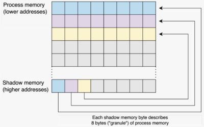

- allocated at a high address of the program
- each byte describes the accessibility status of a memory chunk that can potentially be accessed by the process
- these memory chunks, granules, are commonly 8 bytes in size and aligned to their size

- if the memory should not be touched by the process, it is called poisoned
- by updating the state of the shadow memory during process execution, ASan can verify the validity of the memory accesses by checking the granule's value

shadow byte state:
- fully accessible: set to 0
- whole granule is poisoned: negative value
- partially addressable: the number of addressable bytes N, is stored
- freed memory on the heap: fd
---
Shadow byte legend (one shadow byte represents 8 application bytes):
 Addressable:           00
 Partially addressable: 01 02 03 04 05 06 07  
 Heap left redzone:       ### fa
 Freed heap region:       ### fd
 Stack left redzone:      ### f1
 Stack mid redzone:       ### f2
 Stack right redzone:     ### f3
 Stack after return:      ### f5
 Stack use after scope:   ### f8
 Global redzone:          ### f9
 Global init order:       ### f6
 Poisoned by user:        ### f7
 Container overflow:      ### fc
 Array cookie:            ### ac
 Intra object redzone:    ### bb
 ASan internal:           ### fe
 Left alloca redzone:     ### ca
 Right alloca redzone:    ### cb
 ---

