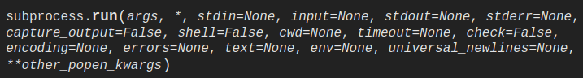
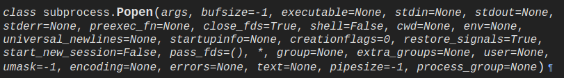
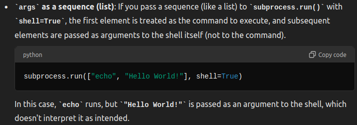
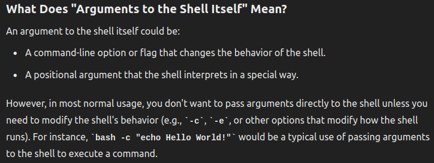

# 1. subprocess.run
It is recommended to use the function **run()** for all use cases it can handle^(1)^

The arguments shown are only the commonly used ones^(1)^

Runs the command described by ***++args++***. Waits for command to finish. Returns a **CompletedProcess** instance^(1)^

## • capture_output:
If true, **stdout** and **stderr** will be captured^(1)^

When used, the internal **Popen** object is automatically created with **stdout** and **stderr** both set to **PIPE**^(1)^

## • timeout:
Internally passed on to **Popen.communicate()**^(1)^

If the **timeout** expires, the child process will be killed and waited for^(1)^

The **TimeoutExpired** exception will be re-raised after the child process has terminated^(1)^

## • input:
It is passed to **Popen.communciate()** and thus to the process's **stdin**^(1)^

If used, it must be a byte sequence, or a string if **encoding** or **errors** is specified or **text** is true^(1)^

When used, the internal **Popen** object is created with **stdin** set to **PIPE**^(1)^

## • check:
If **check** is true, and the process exits with a non-zero exit code, a **CalledProcessError** exception will be raised^(1)^

## • encoding, error, text:
If **encoding** or **errors** are specified or **text** is true, file objects for **stdin**, **stdout** and **stderr** are opened in text mode using the specified **encoding** and **errors** or the **io.TextIOWrapper** default^(1)^

## • universal_newlines:
Is equivalent to **text** but is provided for backwards compatibility^(1)^

## • env:
If **env** is not **None**, it must be a mapping that defines the environment variables for the new process; these are used instead of the default behavior of inheriting the current process' environment. It is passed directly to **Popen**^(1)^

# 2. class subprocess.CompletedProcess
The return value from **run()**, representing a process that has finished^(1)^

## • args:
The arguments for the process. Can be a string or a list^(1)^

## • returncode:
Exit status of the child process. Typically an exit status of 0 indicates it ran successfully^(1)^

## • stdout:
Captured **stdout** from the child process. A byte sequence, or a string if **run()** was called with an **encoding**, **errors**, or **text=True**^(1)^

## • stderr:
Captured **stderr** from the child process. A byte sequence, or a string if **run()** was called with an **encoding**, **errors**, or **text=True**^(1)^

# 3. subprocess.DEVNULL
Can be used as the **stdin**, **stdout** and **stderr** argument to **Popen**. Indicates the special file **os.devnull** will be used^(1)^

# 4. subprocess.PIPE
Can be used as the **stdin**, **stdout** and **stderr** argument to **Popen**. Indicates that a pipe to the standard stream should be opened. Most useful with **Popen.communicate()**^(1)^

# 5. subprocess.STDOUT
Can be used as the **stderr** argument to **Popen**. Indicates the standard error go to the same handle as standard output^(1)^

# 6. exception subprocess.SubprocessError
Base class for all exceptions from this module^(1)^

# 7. exception subprocess.TimeoutExpired
## • cmd:
Command that was used to spawn the child process^(1)^

## • timeout:
Timeout in seconds^(1)^

## • output:
Output by the child process if it was captured by **run()** or **check_output()**. Otherwise, **None**^(1)^

This is always bytes when any output was captured, regardless of the **text=True** setting^(1)^

May remain **None** instead of **b''** when no output was observed^(1)^

## • stdout:
Alias for **output**, for symmetry with **stderr**^(1)^

## • stderr:
**stderr** output of the child process if it was captured by **run()**. Otherwise, **None**^(1)^

This is always bytes when any **stderr** output was captured, regardless of the **text=True** setting^(1)^

May remain **None** instead of **b''** when no **stderr** output was observed^(1)^

# 8. exception subprocess.CalledProcessError
Raised when a process run by **check_call()**, **check_output()**, or **run()**(with **check=True**) returns a non-zero exit status^(1)^

## • returncode:
Exit status of the child process. If the process was exited due to a signal, this will be a negative signal number^(1)^

## • cmd:
Command that was used to spawn the child process^(1)^

## • output:
Output by the child process if it was captured by **run()** or **check_output()**. Otherwise, **None**^(1)^

## • stdout:
Alias for **output**, for symmetry with **stderr**^(1)^

## • stderr:
**stderr** output of the child process if it was captured by **run()**. Otherwise, **None**^(1)^

# 9. class subprocess.Popen
^(1)^
## • args:
On POSIX, if **args** is a string, it is interpreted as the name or path of the program to execute. Arguments cannot be passed to the program like this. To pass arguments, **args** should be a list of strings^(1)^ (the **split()** function is useful for this)

## • shell:
The **shell** argument specifies whether to use the shell as the program to execute^(1)^

If **shell=True** it is recommended to pass args as a string rather than a sequence^(1)^

On POSIX with **shell=True** the shell defaults to /bin/sh. If **args** is a string, the string specified the command to execute through the shell, thus the string must be formatted in exactly that way. If **args** is a sequence, the first item specifies the command string and any additional items will be treated as additional arguments to the shell itself^(1)^

With **shell=True** the additional items are treated as arguments to the shell not to the command. To pass arguments to a program, a string should be used

## • stdin, stdout, stderr:
Valid values are: **None**, **PIPE**, **DEVNULL**, an existing file descriptor and an existing file object^(1)^

---
reference:
(1): <https://docs.python.org/3/library/subprocess.html#popen-constructor>
