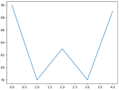
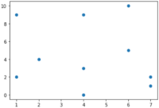
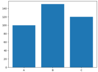
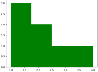
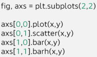
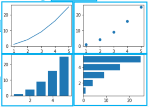

1. visualization
- show()
- plot()

- scatter()

- bar()/barh()

- hist()

- subplots()


- figure()

```python3
fig = plt.figure()
ax1 = fig.add_subplot(221)
ax2 = fig.add_subplot(2, 2, 2)
ax3 = fig.add_subplot(223)
ax4 = fig.add_subplot(224)
ax1.hist(arr1)
ax2.plot(arr2)
ax3.bar(arr3)
ax4.plot(arr4)
ax1.title.set_text('First Plot')
ax2.title.set_text('Second Plot')
ax3.title.set_text('Third Plot')
ax4.title.set_text('Fourth Plot')
plt.show()
```


2. labels
- title()
- xlabel()
- ylabel()

reference:
- 가천대 - Python programming