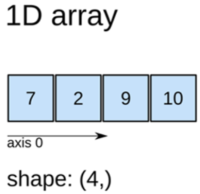
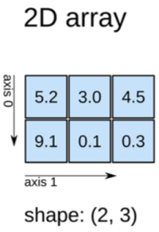
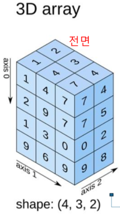

1. array()
- convert to numpy array

```python3
arr1 = np.array([1, 2, 3])
arr2 = np.array([[1, 2, 3], [4, 5, 6]])
```


2. array manipulation
- shape()
- reshape()
- concatenate()
- split(): split on index or section count

3. axis




4. random numbers
- random.randint(low, high=None, size=None, dtype=int)
- random.exponential(scale=1.0, size=None)
- random.choice(a, size=None, replace=True, p=None)

reference:
- 가천대 - Python programming