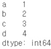
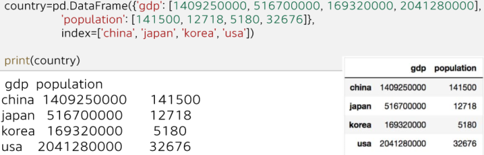
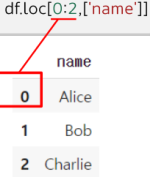
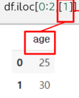

1. series
- saves data and indices

```python3
data=pd.Series([1, 2, 3, 4], index=['a', 'b', 'c', 'd'])
print(data)
data['b']
```



2. DataFrame

- has rows and columns
- can perform operations on cells
- view size with shape()

3. read/write
- to_csv()
- to_excel()
- read_csv()
- read_excel()

4. pandas slicing
- loc(): uses column names
- iloc(): uses numbers



5. data check
- isnull()
- notnull()
- dropna()
- fillna()

6. aggregate functions
- sum()
- mean()
- sort_values()

7. search for data
- query()

```python3
df_filter = df.query('age>=30')
```


8. apply function
- apply(func, axis=0, raw=False)
   - raw: pass parameter as array(True) or Series(False)

```python3
def sum_array(arr):
	return arr.sum()

sum_arrays = df.apply(sum_array, axis=0, raw=True)
```


reference:
- 가천대 - Python programming
