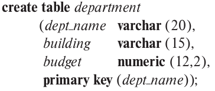
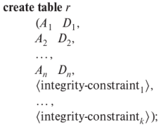
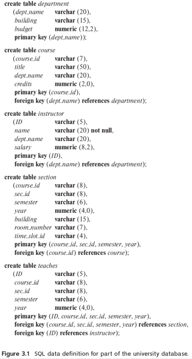
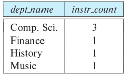

# 3.1 Overview of the SQL Query Language
IBM developed the original version of SQL in the early 1970s

In 1986, the American National Standards Institute (ANSI) and the International Organization for Standardization (ISO) published an SQL standard, called SQL-86. The SQL standard kept getting updated with new standards: SQL-89, SQL-92, SQL:1999, SQL:2003, SQL:2006, SQL:2008, SQL:2011, SQL:2016

The SQL language has several parts:
- Data-definition language (DDL)
The SQL DDL provides commands for defining relation schemas, deleting relations, and modifying relation schemas

- Data-manipulation language (DML)
The SQL DML provides the ability to query information from the db and to insert tuples into, delete tuples from, and modify tuples in the db

- Integrity
The SQL DDL includes commands for specifying integrity constraints that the data stored in the db must satisfy. Updates that violate integrity constraints are disallowed

- View definition
The SQL DDL includes commands for defining views

- Transaction control
SQL includes commands for specifying the beginning and end points of transactions

- Embedded SQL and dynamic SQL
Embedded and dynamic SQL define how SQL statements can be embedded within general-purpose programming languages, such as C, C++ and JAVA

- Authorization
The SQL DDL includes commands for specifying access rights to relations and views

# 3.2 SQL Data Definition
The set of relations in a db are specified using a data-definition language (DDL). The SQL DDL allows specification of not only a set of relations, but also information about each relation, including:
- The schema for each relation
- The types of values associated with each attribute
- The integrity constraints
- The set of indices to be maintained for each relation
- The security and authorization information for each relation
- The physical storage structure of each relation on disk

## 3.2.1 Basic Types
The SQL standard supports a variety of built-in types:
- char(n)
A fixed-length character string with user-specified length n. The full form **character** can be used instead

- varchar(n)
A variable-length character string with user-specified max length n. The full form, **character varying**, is equivalent

- int
An integer (a finite subset of the integers that is machine dependent). The full form, **integer**, is equivalent

- smallint
A small integer (a machine-dependent subset of the integer type)

- numeric(p,d)
A fixed-point number with user-specified precision. 

The number consists of p digits (plus a sign), and d of the p digits are to the right of the decimal point. 

- real, double precision
Floating-point precision and double-precision floating-point numbers with machine-dependent precision

- float(n)
A floating-point number with precision of at least n digits

Each type may include a special value called the **null** value. It indicates an absent value that may exist and is unknown or doesn't exist at all

When comparing two values of type char, if they are different lengths, extra spaces are automatically attached to the shorter one to make them the same size before the comparison. However, this may or may not be done depending on the db system. To avoid complications, it is recommended to use varchar instead of char

SQL also provides the **nvarchar** type to store multilingual data using the Unicode representation. However, many dbs allow Unicode to be stored even in varchar types

## 3.2.2 Basic Schema Definition

This creates a relation *department* in the db. 

The relation has 3 attributes, *dept_name*, *building*, and *budget*.

The **create table** command also specifies that the *dept_name* attribute is the primary key of the *department* relation. 

The general form of the create table command is:

r is the name of the relation, each A~i~ is the name of an attribute in the schema of relation r, and D~i~ is the domain of attribute A~i~ along with optional constraints that restrict the set of allowed values for A~i~

The semicolon shown at the end of the statement, as well as the end of other SQL statements, is optional in many SQL implementations. 

SQL supports a number of different integrity constraints:
- primary key (A~j_1~, A~j_2~, ... , A~j_m~) 
The primary-key specification says that attributes A~j_1~, A~j_2~, ... , A~j_m~ form the primary key for the relation. The primary-key attributes are required to be **nonnull** and **unique**. 

Although the primary-key specification is optional, it is generally a good idea to specify a primary key for each relation

- foreign key (A~k_1~, A~k_2~, ... , A~k_n~) references s
The foreign key specification says that the values of attributes (A~k_1~, A~k_2~, ... , A~k_n~) for any tuple in the relation must correspond to values of the primary key attributes of some tuple in relation s.

- not null
the **not null** constraint on an attribute specifies that the null value is not allowed for that attribute. 



SQL prevents any update to the db that violates an integrity constraint. 

A newly created relation is empty initially. Inserting tuples in a relation, updating them, and deleting them are done by data manipulation statements **insert**, **update**, and **delete**.

To remove a relation from an SQL db, we use the **drop table** command:
**drop table** r;
It deletes all information about the dropped relation from the db. 

**delete from** r; 
retains the relation r, but deletes all tuples in r. 

After a relation is dropped, no tuples can be inserted into it unless it is recreated.

We use the **alter table** command to add attributes to an existing relation. All tuples in the relation are assigned null as the value for the new attribute. The form of the alter table command is:
**alter table** r **add** A D;
where r is the name of an existing relation, A is the name of the attribute to be added, and D is the type of the added attribute

We can drop attributes from a relation by the command:
**alter table** r **drop** A;

# 3.3 Basic Structures of SQL Queries
The basic structure of an SQL query consists of 3 clauses: **select**, **from**, **where**.

A query takes as its input the relations listed in the from clause, operates on them as specified in the where and select clauses, and then produces a relation as the result

## 3.3.1 Queries on a Single Relation

```sql
select name
from instructor;
```

The result is a relation consisting of a single attribute with the heading *name*.


```sql
select dept_name
from instructor;
```

Since a department name can appear more than once in the *instructor* relation, the results may contain duplicate department names. SQL allows duplicates in db relations as well as in the results of SQL expressions


```sql
select distinct dept_name
from instructor;
```

This will remove the duplicates

The select clause may also contain arithmetic expressions involving the operators +, -, *, and / operating on constants or attributes of tuples.

SQL also provides special data types, such as various forms of the **date** type, and allows several arithmetic functions to operate on these types

The where clause allows us to select only those rows in the result relation of the from clause that satisfy a specified predicate:

```sql
select name
from instructor
where dept_name = 'Comp.Sci.' and salary > 70000;
```


SQL allows the use of logical connectives **and**, **or**, and **not** in the where clause.

The operands of logical connectives can be expressions involving the comparison operators <, <=, >, >=, = and <>.

SQL allows us to use the comparison operators to compare strings and arithmetic expressions as well as special types, such as date types

## 3.3.2 Queries on Multiple Relations

```sql
select name, instructor.dept_name, building
from instructor, department
where instructor.dept_name = department.dept_name;
```

This will retrieve the names of all instructors, along with their department name and building

The naming convention requires that the relations that are present in the from clause have distinct names. This requirement causes problems in some cases, such as when info from 2 different tuples in the same relation need to be combined.

The role of each clause is:
- The **select** clause is used to list the attributes desired in the result of a query
- The **from** clause is a list of the relations to be accessed in the evaluation of the query
- The **where** clause is a predicate involving attributes of the relation in the from clause

A typical SQL query has the form:

Each A~i~
```sql
select A_1, A_2, ..., A_n
from r_1, r_2, ..., r_m
where P;
```
 represents an attribute, and each r~i~ is a relation. P is a predicate.

If the where clause is omitted, the predicate P is true

The clauses must be written in the order select, from, where. However, it is easiest to understand the query considering the clauses in order: from, where, and select

The from clause by itself defines a Cartesian product of the relations listed in the clause. 

The predicate in the where clause is used to restrict the combinations created by the Cartesian product.

In general, the meaning of an SQL query can be understood as follows:
1. Generate a Cartesian product of the relations listed in the from clause
2. Apply the predicates specified in the where clause on the result of step 1
3. For each tuple in the result of step 2, output the attributes specified in the select clause

# 3.4 Additional Basic Operations
## 3.4.1 The Rename Operation
The names of the attributes in the result are derived from the names of the attributes in the relations in the from clause.

However, we can't always derive names this way:
1. Two relations in the from clause may have attributes with the same name. 
2. If we use an arithmetic expression in the select clause, the resultant attribute doesn't have a name
3. Even if an attribute name can be derived from the base relations, we may want to change the attribute name in the result

---
## Note 3.1 SQL AND MULTISET RELATIONAL ALGEBRA - PART 1
There is a close connection between relational algebra operations and SQL operations, but 1 difference is that SQL allows duplicates. 

To model this behavior of SQL, a version of relational algebra, called the multiset relational algebra, is defined to work on multisets, which are sets that may contain duplicates

The basic operations are defined as follows:
1. If there are c~1~ copies of tuple t~1~ in r~1~, and t~1~ satisfies selection σ~θ~, then there are c~1~ copies of t~1~ in σ~θ~(r~1~)
2. For each copy of tuple t~1~ in r~1~, there is a copy of tuple Π~A~(t~1~) in Π~A~(r~1~), where Π~A~(t~1~) denotes the projection of the single tuple t~1~
3. If there are c~1~ copies of tuple t~1~ in r~1~ and c~2~ copies of tuple t~2~ in r~2~, there are c~1~*c~2~ copies of the tuple t~1~.t~2~ in r~1~×r~2~

The relational algebra **select** operation corresponds to the SQL where clause, not the select clause
---

The **as** clause is used to rename the attributes of a result relation:
*old-name* **as** *new-name*

The as clause can appear in both the select and from clauses

An identifier, such as T and S, that is used to rename a relation is referred to as a **correlation name** in the SQL standard, but is also commonly referred to as a **table alias**, **correlation variable**, or a **tuple variable**

## 3.4.2 String Operations
SQL specifies strings by enclosing them in single quotes. A single quote character that is part of a string can be specified using two single quote characters

The SQL standard specifies that the equality operation on strings is case sensitive. However, some db systems, such as MySQL and SQL Server, do not distinguish uppercase from lowercase when matching strings.

SQL also permits a variety of functions on character strings, such as concatenating using ||, extracting substrings, finding the lengths of strings, converting strings to uppercase/lowercase by using the function upper(s)/lower(s), removing spaces at the end of the string using trim(s), and so on

There are variations on the exact set of string functions supported by different db systems

Pattern matching can be performed on strings using the operator **like**. We describe patterns by using 2 special characters:
- Percent(%): matches any substring
- Underscore(_): matches any character
Patters are case sensitive, meaning uppercase characters do not match lowercase characters and vice versa

Examples of using pattern matching:
- ‘Intro%’ matches any string starting with ‘Intro’
- ‘%Comp%’ matches any string containing “Comp” as a substring
- ‘___' matches any string of exactly 3 characters
- ‘___%’ matches any string of at least 3 characters

```sql
select dept_name
from department
where building like '%Watson%';
```

Chooses all buildings that include Watson as a substring

For pattern to include special pattern characters, SQL allows the specification of an escape character using the **escape** keyword:
**like** ‘ab\%cd%’ **escape** ‘\’ matches all strings beginning with “ab%cd”

SQL allows us to search for mismatches instead of matches by using the **not like** comparison operator

Some SQL implementations, notably PostgreSQL, offer a **similar to** operation that provides more powerful pattern matching than the like operation

## 3.4.3 Attribute Specification in the Select Clause
The asterisk symbol ‘*’ can be used in the select clause to denote all attributes:

```sql
select instructor.*
from instructor, teaches
where instructor.ID=teaches.ID;
```

all attributes of *instructor* are selected

## 3.4.4 Ordering the Display of Tuples
The **order by** clause causes the tuples in the result of a query to appear in sorted order:

```sql
select name
from instructor
where dept_name = 'Physics'
order by name;
```

Lists in alphabetical order all the instructors in the Physics department

By default, the order by clause lists items in ascending order. To specify the sort order, we may specify **desc** or **asc**.

Furthermore, ordering can be performed on multiple attributes:

```sql
select *
from instructor
order by salary desc, name asc;
```

If several instructors have the same salary, it orders them in ascending order by name

## 3.4.5 Where-Clause Predicates
SQL includes a **between** comparison operator to simplify where clauses that specify that a value be less than or equal to some value and greater than or equal to some other value:

```sql
select name
from instructor
where salary between 90000 and 100000;
```


Similarly, we can use the **not between** comparison operator.

SQL permits us to use the notation (v~1~, v~2~, ..., v~n~) to denote a tuple of arity n containing values v~1~, v~2~, ..., v~n~. The notation is called a **row constructor**. 

The comparison operators can be used on tuples, and the ordering is defined lexicographically. For example, if (a~1~, a~2~) <= (b~1~, b~2~) is true, a~1~ <= b~1~ and a~2~ <= b~2~. Thus, 

is equal to:

```sql
select name, course_id
from instructor, teaches
where instructor.ID=teaches.ID and dept_name = 'Biology';
```


```sql
select name, course_id
from instructor, teaches
where (instructor.ID, dept_name) = (teaches.ID, 'Biology');
```
# 3.5 Set Operations
The SQL operations **union**, **intersect**, and **except** operate on relations and correspond to the mathematical set operations ∪, ∩, and −.


```sql
select course_id
from section
where semester='Fall' and year=2017;
```

```sql
select course_id
from section
where semester='Spring' and year=2018;
```

The relations obtained from the preceding queries are referred to as c1 and c2.

## 3.5.1 The Union Operation

```sql
(select course_id
from section
where semester = 'Fall' and year=2017)
union
(select course_id
from section
where semester = 'Spring' and year=2018);
```

The parentheses are optional.

The union operation automatically eliminates duplicates, unlike the select clause. If we want to retain all duplicates, we must write **union all** in place of union

The number of duplicate tuples in the result is equal to the number of duplicates that appear in both relations

## 3.5.2 The Intersect Operation

```sql
(select course_id
from section
where semester = 'Fall' and year=2017)
intersect
(select course_id
from section
where semester = 'Spring' and year=2018);
```

The intersect operation automatically eliminates all duplicates.

We can use **intersect all** to retain all duplicates. The number of duplicates is equal to the minimum number of duplicates in both relations.

3.5.3 The Except Operation

```sql
(select course_id
from section
where semester = 'Fall' and year=2017)
except
(select course_id
from section
where semester = 'Spring' and year=2018);
```

The operation automatically eliminates duplicates and we can use **except all** to retain duplicates

The number of duplicates is equal to the number of duplicates in the first relation minus the number of duplicates in the second relation

# 3.6 Null Values
The result of an arithmetic expression is null if any of the input values is null. 

SQL treats **unknown** as the result of any comparison involving a null value. This creates a third logical value in addition to true and false.

The definitions of the Boolean operations and, or, and not are also extended to deal with the value unknown:
- and:
The result of true and unknown is true, false and unknown is false, while unknown and unknown is unknown

- or:
The result of true or unknown is true, false or unknown is unknown, and unknown and unknown is unknown

- not:
The result of not unknown is unknown

If the where clause predicate evaluates to either false of unknown for a tuple, that tuple is not added to the result.

SQL uses the special keyword null in a predicate to test for a null value:

```sql
select name
from instructor
where salary is null;
```

Finds all instructors with a null value for the salary

The predicate **is not null** succeeds if the value on which it is applied is not a null. 

SQL allows us to test whether the result of a comparison is unknown, rather than true of false, using the clauses **is unknown** and **is not unknown**:

```sql
select name
from instructor
where salary > 10000 is unknown;
```

Finds all instructors with a null value for the salary

When comparing values of corresponding attributes from 2 tuples, the values are treated as identical if either both are non-null and equal in value, or both are null. Note that it is different from nulls in predicates where a comparison null=null would return unknown, rather than true

The approach of treating tuples as identical if they have the same values for all attributes, even if some of the values are null, is also used for the set operations union, intersection, and except.

# 3.7 Aggregate Functions
Aggregate functions are functions that take a collection of values as input and return a single value. SQL offers five standard built-in aggregate functions:
- Average: **avg**
- Minimum: **min**
- Maximum: **max**
- Total: **sum**
- Count: **count**

The input to sum and avg must be a collection of numbers, but the other operators can operate on nonnumeric data types, such as strings, as well

## 3.7.1 Basic Aggregation

```sql
select avg(salary)
from instructor
where dept_name='Comp.Sci';
```

The result of this query is a relation with a single attribute containing a single tuple with a numerical value corresponding to the average salary of instructors in the Computer Science department

The db system may give an awkward name to the result relation attribute.

Retaining duplicates is important in computing an average, since the value would change if eliminating duplicates.

There are cases where we must eliminate duplicates before computing an aggregate function. We can use the keyword distinct in the aggregate expression:

```sql
select count (distinct ID)
from teaches
where semester='Spring' and year=2018;
```


We use the aggregate function count frequently to count the number of tuples in a relation. The notation for this function is SQL is count(*)

```sql
select count(*)
from course;
```


SQL does not allow the use of distinct with count. But it is legal to use distinct with min and max, though the result doesn't change.

We can use the keyword **all** in place of distinct to specify duplicate retention, but there is no need to do so since it is the default

## 3.7.2 Aggregation with Grouping
There are circumstances where we would like to apply the aggregate function not only to a single set of tuples, but also to a group of sets of tuples. 

This is specified in SQL using the **group by** clause. 

The attribute or attributes given in the group by clause are used to form groups. Tuples with the same value on all attributes in the group by clause are placed in one group.


```sql
select dept_name, avg(salary) as avg_salary
from instructor
group by dept_name;
```

This allows the avg aggregate to be computed for each group, not the set of all instructors, resulting in a relation with the same amount of tuples as the groups


```sql
select dept_name, count(distinct ID) as instr_count
from instructor, teaches
where instructor.ID=teaches.ID and semester='Spring' and year=2018
group by dept_name;
```


When an SQL query uses grouping, it is important to ensure that the only attributes that appear in the select statement without being aggregated are those that are present in the group by clause. 

```sql
/*erroneous query*/
select dept_name, ID, avg(salary)
from instructor
group by dept_name;
```

Each instructor in a particular group can have a different ID, and since only one tuple is output for each group, there is no unique way of choosing which ID value to output. As such, these cases are disallowed by SQL.

## 3.7.3 The Having Clause
Sometimes, it is useful to have a condition that applies to groups rather than tuples. The having clause is one of them. 

```sql
select dept_name, avg(salary) as avg_salary
from instructor
group by dept_name
having avg (salary)>42000;
```


As was the case for the select clause, any attribute that is present in the having clause without being aggregated must appear in the group by clause, otherwise the query is erroneous. 

The meaning of a query containing aggregation, group by, or having clauses is defined by:
- The from clause is first evaluated
- If a where clause is present, the predicate in the where clause is applied on the result of the from clause
- Tuples satisfying the where predicate are placed into groups if the clause is present. If not, the entire set is treated as one group
- If the having clause is present, it is applied to each group. The groups that do not satisfy are removed
- The select clause uses the groups to generate the result of the query, applying the aggregate function to get a single result tuple

## 3.7.4 Aggregation with Null and Boolean Values
All aggregate functions except **count(*)** ignore null values in their input collection, and as a result, the collection may be empty

The count of an empty collection is 0 and the other aggregate operations return a value of null when applied on an empty collection

A **Boolean** data type can take values true, false, and unknown. The aggregate functions **some** and **every** can be applied on a collection of Boolean values, and compute the disjunction(or) and conjunction(and) respectively

---
## Note 3.2 SQL AND MULTISET RELATIONAL ALGEBRA-PART 2
The relational algebra union, intersection and set difference operations can be extended to the multiset relational algebra, following the definitions of **union** **all**, **intersect** **all**, and **except** **all** in SQL, the SQL **union**, **intersect**, and **except** correspond to the set version of ∪, ∩, and −.

The extended relational algebra aggregate operation γ permits the use of aggregate functions on relation attributes.

The operation ~dept_name~γ~average(salary)~(instructor) groups the instructor relation on the dept_name attribute and computes the average salary for each group. The subscript on the left side may be omitted, resulting in the entire input relation being in a single group.

The aggregated values do not have an attribute name, but can be given a name using the rename operator or for convenience using “average(salary) as avg_salary”

Complex SQL queries can be rewritten in relational algebra:

is equivalent to:
t1←σ~P~
```sql
select A1, A2, sum(A3)
from r1, r2, ..., rm
where P
group by A1, A2, having count(A4)>2
```
(r1×r2×...×rm)
Π~A1, A2, SumA3~(σ~countA4>2~(~A1,A2~γ~sum(A3) as SumA3, count(A4) as countA4~(t1)))

Subqueries in the where or select clause cannot be rewritten in such a straightforward manner, since there is no relational algebra operation equivalent to the subquery construct.
---

# 3.8 Nested Subqueries
SQL provides a mechanism for nesting subqueries.

A subquery is select-from-where expression that is nested within another query.

## 3.8.1 Set Membership
SQL allows testing tuples for membership in a relation. The **in** connective tests for set membership, where the set is a collection of values produced by a select clause. The **not** **in** connective tests for the absence of set membership.


```sql
select distinct course_id
from section
where semester = 'Fall' and year=2017 and
	course_id in(select course_id
				 from section
				 where semester = 'Spring' and year = 2018);
```

```sql
select distinct course_id
from section
where semester = 'Fall' and year=2017 and
	course_id not in(select course_id
					 from section
					 where semester = 'Spring' and year=2018);
```

Note the use of distinct here.

The in and not in operators can also be used on enumerated sets.

```sql
select distinct name
from instructor
where name not in ('Mozart', 'Einstein');
```


It is also possible to test for membership in an arbitrary relation in SQL:

```sql
select count(distinct ID)
from takes
where (course_id, sec_id, semester, year) in (select course_id, sec_id, semester, year
											   from teaches
											   where teaches.ID='10101');
```

Some SQL implementations do not allow the row construction syntax, (course_id, sec_id, semester, year), used

## 3.8.2 Set Comparison
The phrase “greater than at least one” is represented in SQL by **> some**:

```sql
select name
from instructor
where salary >some(select salary
				   from instructor
				   where dept_name = 'Biology');
```

 This construct allows us to rewrite a query in a form that resembles closely our formation of the query in English, “Find the name of all instructors whose salary is greater than at least one instructor in the Biology department”
 
SQL also allows <some, <=some, >=some, =some and <>some operations.

The =some is identical to in, where as <>some is not the same as not in.

The construct > **all** corresponds to the phrase “greater than all". As it does for some, SQL also allows <all, <=all, >=all, =all, and <>all comparisons.

<>all is identical to not n, whereas =all is not the same as in.

## 3.8.3 Test for Empty Relations
SQL includes a feature for testing whether a subquery has any tuples in its result. The **exist** construct returns the value true if the argument subquery is nonempty


```sql
select course_id
from section as S
where semester = 'Fall' and year=2017 and
	exists(select *
		   from section as T
		   where semester = 'Spring' and year=2018 and
				S.course_id=T.course_id);
```

“Find all courses taught in both the Fall 2017 semester and in the Spring 2018 semester”

Note the feature of SQL where a correlation name from an outer query, S, can be used in a subquery in the where clause. A subquery that uses a correlation name from an outer query is called a correlated subquery.

In a subquery, it is legal to only use correlation names defined in the subquery itself or in any query that contains the subquery. If a correlation name is defined both locally and globally, the local definition applies.

We can test for the nonexistence of tuples in a subquery by using the **not** **exists** construct. 

It can be used to simulate the set containment operation. “relation A contains relation B” can be written as “not exists(B except A)”


```sql
select S.ID, S.name
from student as S
where not exists ((select course_id
					from course
					where dept_name='Biology')
					except
					(select T.course_id
					from takes as T
					where S.ID = T.ID));
```

“Find all students who have taken all courses offered in the Biology department”


```sql
select count (distinct ID)
from takes
where exists(select course_id, sec_id, semester, year
			 from teaches
			 where teaches.ID='10101'
				and takes.course_id = teaches.course_id
				and takes.sec_id = teaches.sec_id
				and takes.semester = teaches.semester
				and takes.year = teaches.year
			);
```
## 3.8.4 Test for the Absence of Duplicate Tuples
SQL includes a Boolean function for testing whether a subquery has duplicate tuples in its result. The **unique** construct returns the value true if the argument subquery contains no duplicate tuples.


```sql
select T.course_id
from course as T
where unique (select R.course_id
			  from section as R
			  where T.course_id = R.course_id and
					R.year=2017);
```

“Find all courses that were offered at most once in 2017”

We can test for the existence of duplicate tuples in a subquery by using the **not** **unique** construct.


```sql
select T.course_id
from course as T
where not unique(select R.course_id
				 from section as R
				 where T.course_id = R.course_id and
						R.year=2017);
```

“Find all courses that were offered at least twice in 2017”

The unique test on a relation is defined to fail if and only if the relation contains two distinct tuples t1 and t2 such that t1=t2. Since the test t1=t2 fails if any of the fields of t1 or t2 are null, it is possible for unique to be true even if there are multiple copies of a tuple, as long as at least one of the attributes of the tuple is null.

## 3.8.5 Subqueries in the From Clause
SQL allows a subquery expression to be used in the from clause. The key concept applied here is that any select-from-where expression returns a relation as a result and, therefore, can be inserted into another select-from-where anywhere that a relation can appear.

```sql
select dept_name, avg_salary
from (select dept_name, avg(salary) as avg_salary
	  from instructor 
	  group by dept_name)
where avg_salary > 42000;
```

“Find the average instructors' salaries of those departments where the average salary is greater than 42000”


```sql
select dept_name, avg_salary
from (select dept_name, avg(salary)
	  from instructor
	  group by dept_name)
	  as dept_avg(dept_name, avg_salary)
where avg_salary > 42000;
```

The subquery result relation is named dept_avg, with the attributes dept_name and avg_salary.

Nested subqueries in the from clause cannot use correlation variables from other relations in the same from clause. 

However, the SQL standard, allows a subquery in the from clause that is prefixed by the **lateral** keyword to access attributes of preceding tables or subqueries in the same from clause.


```sql
select name, salary, avg_salary
from instructor I1, lateral(select avg(salary) as avg_salary
							from instructor I2
							where I2.dept_name = I1.dept_name);
```

“Print the names of each instructor, along with their salary and the average salary in their department”

## 3.8.6 The With Clause
The **with** clause provides a way of defining a temporary relation whose definition is available only to the query in which the with clause occurs.


```sql
with max_budget (value) as
	(select max(budget)
	 from department)
select budget
from department, max_budget
where department.budget=max_budget.value;
```


The with clause in the query defines the temporary relation max_budget containing the results of the subquery defining the relation. This relation is available for use only within later parts of the same query.

Most, but not all db systems support the with clause.

Using the nested subquery in the with clause instead of the from clause makes the logic clearer.


```sql
with dept_total (dept_name, value) as
	(select dept_name, sum(salary)
	 from instructor
	 group by dept_name),
dept_total_avg(value) as
	(select avg(value)
	 from dept_total)
select dept_name
from dept_total, dept_total_avg
where dept_total.value > dept_total_avg.value;
```

“Find all departments where the total salary is greater than the average of the total salary of all departments”

