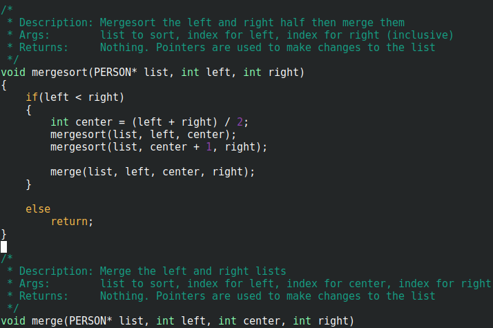
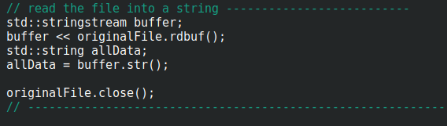

# 1. Comment the Why not the What

2. Save comments for Non-obvious code

3. Document functions and classes

Source: Baekjoon/25329/source.cpp
# 
4. Use TODOs and FIXMEs

5. Update the comments when the code is changed

6. Use comment blocks to separate sections of code

Source: editEncryptedFile.cpp# 

7. Be consistent

8. Ask for feedback