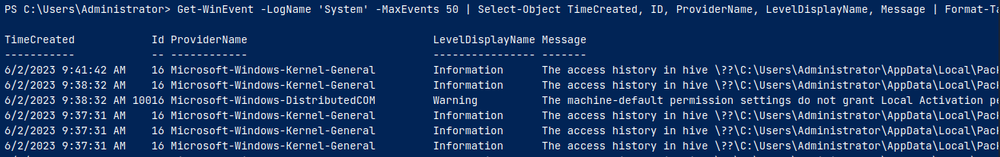
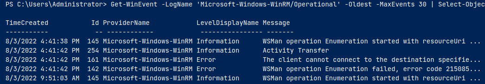
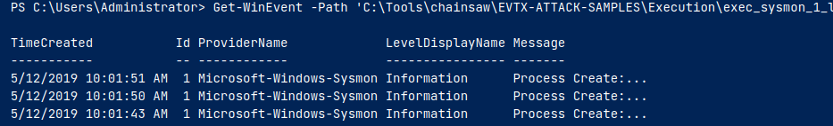
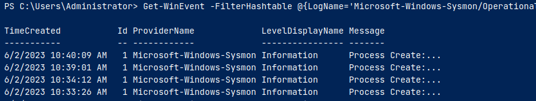
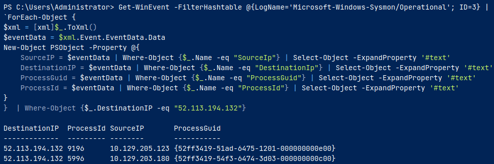
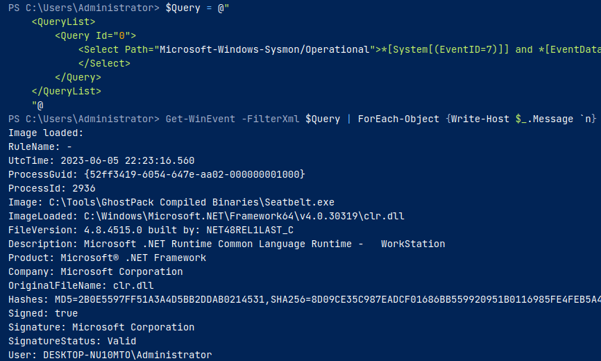
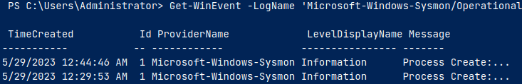
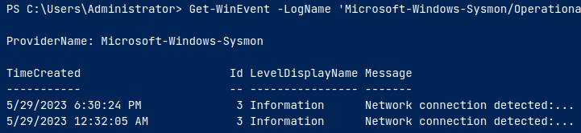
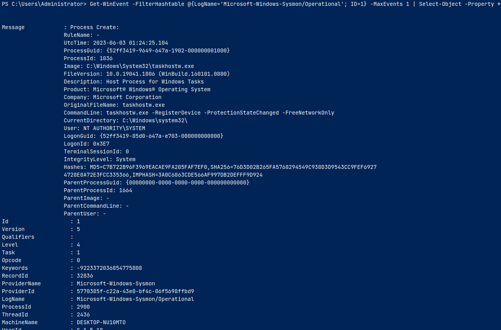
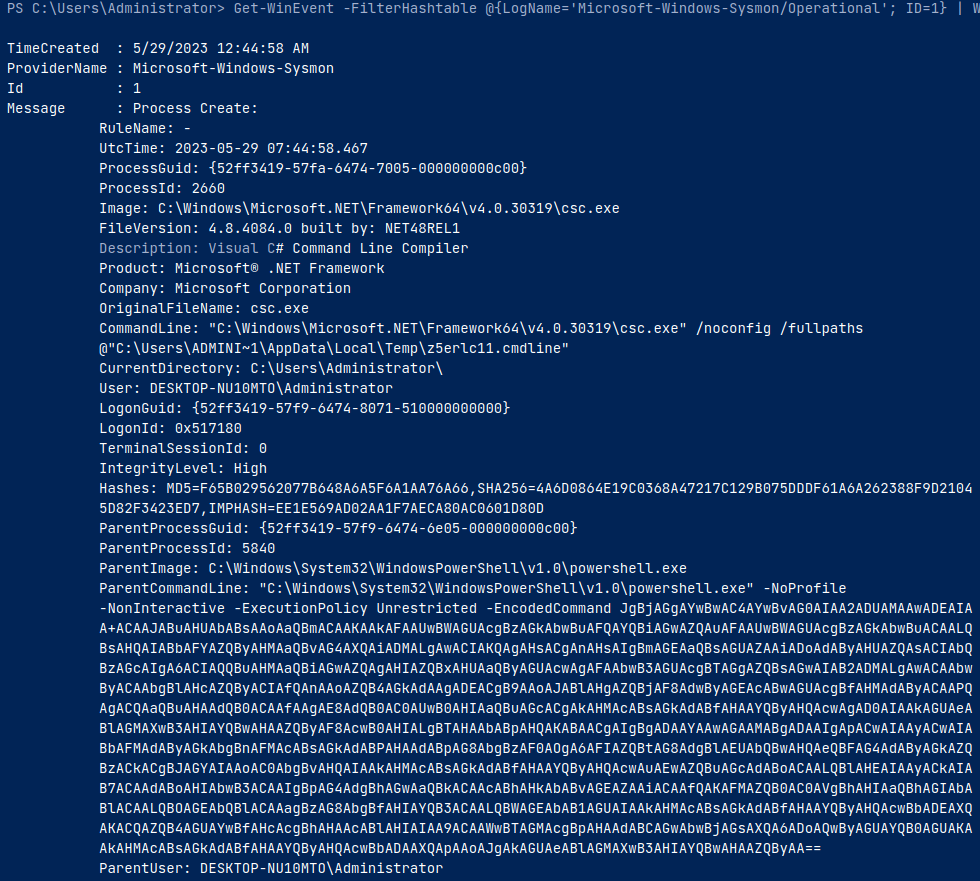

1. Get-WinEvent
- tool for analyzing logs en masse
- can retrieve different types of event logs

2. example uses
2.1. retrieving events from the system log

```powershell
Get-WinEvent -LogName 'System' -MaxEvents 50 | Select-Object TimeCreated, ID, ProviderName, LevelDisplayName, Message | Format-Table -AutoSize
```



2.2. retrieving events from Microsoft-Windows-WinRM/Operational


```powershell
Get-WinEvent -LogName 'Microsoft-Windows-WinRM/Operational' -Oldest -MaxEvents 30 | Select-Object TimeCreated, ID, ProviderName, LevelDisplayName, Message | Format-Table -AutoSize
```

- -Oldest parameter to retrieve first events

2.3. retrieving events from .evtx files


```powershell
Get-WinEvent -Path 'C:\Tools\chainsaw\EVTX-ATTACK-SAMPLES\Execution\exec_sysmon_1_lolbin_pcalua.evtx' -MaxEvents 5 | Select-Object TimeCreated, ID, ProviderName, LevelDisplayName, Message | Format-Table -AutoSize
```

- -Path parameter for log path

2.4. filtering events with FilterHashtable


```powershell
Get-WinEvent -FilterHashtable @{LogName='Microsoft-Windows-Sysmon/Operational'; ID=1,3} | Select-Object TimeCreated, ID, ProviderName, LevelDisplayName, Message | Format-Table -AutoSize
```

```powershell
Get-WinEvent -FilterHashtable @{Path='C:\Tools\chainsaw\EVTX-ATTACK-SAMPLES\Execution\sysmon_mshta_sharpshooter_stageless_meterpreter.evtx'; ID=1,3} | Select-Object TimeCreated, ID, ProviderName, LevelDisplayName, Message | Format-Table -AutoSize
```

```powershell
$startDate = (Get-Date -Year 2023 -Month 5 -Day 28).Date
$endDate   = (Get-Date -Year 2023 -Month 6 -Day 3).Date
Get-WinEvent -FilterHashtable @{LogName='Microsoft-Windows-Sysmon/Operational'; ID=1,3; StartTime=$startDate; EndTime=$endDate} | Select-Object TimeCreated, ID, ProviderName, LevelDisplayName, Message | Format-Table -AutoSize
```


2.5. filtering events with FilterHashtable & XML


```powershell
Get-WinEvent -FilterHashtable @{LogName='Microsoft-Windows-Sysmon/Operational'; ID=3} |
`ForEach-Object {
$xml = [xml]$_.ToXml()
$eventData = $xml.Event.EventData.Data
New-Object PSObject -Property @{
    SourceIP = $eventData | Where-Object {$_.Name -eq "SourceIp"} | Select-Object -ExpandProperty '#text'
    DestinationIP = $eventData | Where-Object {$_.Name -eq "DestinationIp"} | Select-Object -ExpandProperty '#text'
    ProcessGuid = $eventData | Where-Object {$_.Name -eq "ProcessGuid"} | Select-Object -ExpandProperty '#text'
    ProcessId = $eventData | Where-Object {$_.Name -eq "ProcessId"} | Select-Object -ExpandProperty '#text'
}
}  | Where-Object {$_.DestinationIP -eq "52.113.194.132"}
```

```powershell
$Query = @"
	<QueryList>
		<Query Id="0">
			<Select Path="Microsoft-Windows-Sysmon/Operational">*[System[(EventID=7)]] and *[EventData[Data='mscoree.dll']] or *[EventData[Data='clr.dll']]
			</Select>
		</Query>
	</QueryList>
	"@
Get-WinEvent -FilterXml $Query | ForEach-Object {Write-Host $_.Message `n}
```


2.6. filtering events with FilterXPath


```powershell
Get-WinEvent -LogName 'Microsoft-Windows-Sysmon/Operational' -FilterXPath "*[EventData[Data[@Name='Image']='C:\Windows\System32\reg.exe']] and *[EventData[Data[@Name='CommandLine']='`"C:\Windows\system32\reg.exe`" ADD HKCU\Software\Sysinternals /v EulaAccepted /t REG_DWORD /d 1 /f']]" | Select-Object TimeCreated, ID, ProviderName, LevelDisplayName, Message | Format-Table -AutoSize
```

- -FilterXPath parameter to craft XPath query to filter event logs
- used to identify installation of any Sysinternal tools via registry key used during EULA acceptance


```powershell
Get-WinEvent -LogName 'Microsoft-Windows-Sysmon/Operational' -FilterXPath "*[System[EventID=3] and EventData[Data[@Name='DestinationIp']='52.113.194.132']]"
```

- to identify network connections to particular IP address

2.7. filtering events based on property values


```powershell
Get-WinEvent -FilterHashtable @{LogName='Microsoft-Windows-Sysmon/Operational'; ID=1} -MaxEvents 1 | Select-Object -Property *
```

- -Property * parameter used with Select-Object instructs the command to select all properties


```powershell
Get-WinEvent -FilterHashtable @{LogName='Microsoft-Windows-Sysmon/Operational'; ID=1} | Where-Object {$_.Properties[21].Value -like "*-enc*"} | Format-List
```

- $_: current object in pipeline 
- .Properties[21].Value: array containing various data about event. Index 21 corresponds to ParentCommandLine property of event

reference:
HTB academy: <https://academy.hackthebox.com/module/216/section/2322>