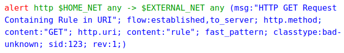

1. rules format
- rules consist of:
   - action: what happens when rule matches
   - header: defining protocol, IP, ports, and direction of rule
   - rule option: specifics of rule


2. action
- valid actions:
   - alert: generate alert
   - pass: stop further inspection of packet
   - drop: drop and generate alert
   - reject: send RST/ICMP unreach error to sender - [1] 
   - rejectsrc: same as reject
   - rejectdst: send RST/ICMP unreach error to receiver 
   - rejectboth: send RST/ICMP unreach error to both

3. protocol
- protocol to apply to
- valid protocols:
   - ip (stands for all or any)
   - tcp
   - udp
   - icmp
   - icmpv4
   - icmpv6
   - ipv4/ip4
   - ipv6/ip6
   - pkthdr (packets without valid headers)
- additional TCP related protocol options:
   - tcp-pkt: matching content in individual tcp packets
   - tcp-stream: matching content only in reassembled tcp stream
- application layer protocols:
   - http
   - http1
   - http2
   - tls (includes ssl)
   - quic
   - ftp (ftp command channel)
   - ftp-data (ftp data channel)
   - smb 
   - dns
   - doh2 (dns over http/2)
   - mdns
   - dcerpc
   - ldap
   - ssh
   - etc etc
- availability of protocols depend on whether it is enabled in config file

4. explicit rule hooks
- protocol field can be used to force evaluation of a rule at a specific explicit protocol state
<proto>:<hook>

5. source and destination
- can assign IP addresses or ranges
- can be combined with operators:
   - ../..: CIDR notation
   - !: negation
   - [..., ...]: grouping
- normally variables from the config file are used

6. ports
- operators can be used:
   - :: port ranges
   - !: negation
   - [..., ...]: grouping

7. direction
- ->: single direction
- <>: bidirection
- =>: bidirection, can use keywords for matching each direction - [2]

8. rule options
- enclosed by parenthesis and separated by semicolons
- some options have settings
<keyword>: <settings>;
<keyword>;

9. disabling alerts
- keyword noalert can be used to disable alert generation

```plain-text
alert http any any -> $HOME_NET any (
msg:"noalert example: set state";
flow:established,to_server;
xbits:set,SC.EXAMPLE,track ip_dst, expire 10;
noalert;
http.method; content:"GET";
sid:1;
)
```

marks state without generating alert


```plain-text
alert http any any -> $HOME_NET any (
msg:"noalert example: state use";
flow:established,to_server;
xbits:isset,SC.EXAMPLE,track ip_dst;
http.method; content:"POST";
sid: 2;
)
```

generates an alert if state is set and additional qualifiers are met

- commonly used in IPS mode to drop packets without generating alerts

```plain-text
drop tcp any any -> any 22 (
msg:"Drop inbound SSH traffic";
noalert;
sid: 3;
)
```


10. modifier keywords
- content modifier:
   - look back in the rule
	
```plain-text
alert http any any -> any any (
content:"index.php";
http_uri;
sid:1;
)
```

- sticky buffer:
   - places buffer name and keywords following it apply to that buffer
	
```plain-text
alert http any any -> any any (
http_response_line; content:"403 Forbidden";
sid:1;
)
```


11. normalized buffers
- normalized buffers are:
   - HTTP-keywords
   - reassembled streams
   - TLS-
   - SSL-
   - SSH-
   - GTP-
   - dcerpc-
- exceptions:
   - http_raw_uri

reference:
- Suricata - rules: <https://docs.suricata.io/en/latest/rules/intro.html>

notes:
[1]: rejects also drops packets in IPS mode
[2]: transactional rules

```plain-text
alert http any any => 5.6.7.8 80 (
msg:"matching both uri and status";
sid: 1;
http.uri; content: "/download";
http.stat_code; content: "200";
)
```

- matches only when Suricata got both request and response


```plain-text
alert http any any => 5.6.7.8 80 (
msg:"matching json to server and xml to client";
sid: 1;
http.content_type: to_server; content: "json";
http.content_type: to_client; content: "xml";
)
```

- can use direction-ambiguous keywords by specifying direction
- limitations:
   - can't use direction-ambiguous keywords
   - only meant to work on transactions with first request to server then reply to client, not other way around
   - cannot have fast_pattern or prefilter direction to client if they also have a streaming buffer on direction to server
   - refuses to load if single direction rule is enough