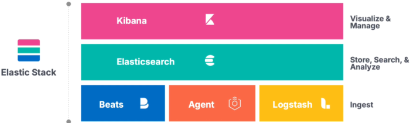
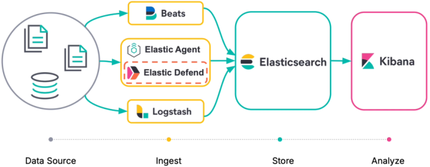

1. ELK stack
- software stack combining Elasticsearch, Logstash, and Kibana
- aggregate/analyze logs 
- create visualizations for infrastructure monitoring

2. ELK stack composition

2.1. Elasticsearch
- distributed search/analytics engine
- handles indexing, storing, and querying

2.2. Logstash
- collect data from various sources
- transform and send data

2.3. Kibana
- data visualization tool
- uses tables, charts, and custom dashboards

2.4. Beats
- forwards data to Logstash/Elasticsearch
- types:
   - Filebeat - log files
   - Metricbeat - metric data from OS or computer usage
   - Packetbeat - network packets
   - Winlogbeat - Windows event logs
   - Auditbeat - Linux logs
   - Heartbeat - computer uptime monitoring

2.5. Agents
- evolved from Beats
- unified way to add monitoring
- over 200+ integrations for added capablilities

references:
- Amazon - ELK stack: <https://aws.amazon.com/what-is/elk-stack/>
- logstail - filebeat: <https://logstail.com/blog/what-is-filebeat-and-why-is-it-important/>
- HTB academy - SOC analyst path
- Elastic - Elastic Security for SIEM: <https://learn.elastic.co/learn/courses/569/elastic-security-for-siem-on-demand/lessons/2132:1368/module-1-elastic-stack-overview>