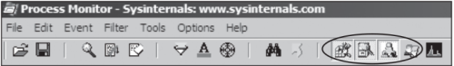

## 1) filtering
### 1.2) automatic filters
turned on by default

- registry
- file system
- process activity
- network

## 2) etc
- use boot logging options to install procmon as a startup driver and capture startup events
