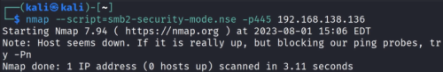
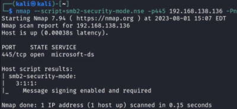

# 1. commands
- usage: nmap -T4 -p- -A <IP address>
- '-T4' is  a speed purpose. Higher number is faster
- ‘-p-’ means it will scan all ports. Without ‘p’, it will only go through the first 1000 ports. With ‘-p <port numbers>’ we can select specific ports to scan
- ‘-A’ find out version, os, fingerprinting etc

- finding host vulnerable to SMB relay attack
nmap --script=smb2-security-mode.nse -p445 <ip address>

# 2. Tips
- it is recommended to use the “-Pn” option to probe even if the ping doesn't work

- sometimes using the “-sT” option is good because it uses tcp connection scan instead of the default SYN scan, especially when it is through proxychains

- the packet-trace option allows for more detailed output
nmap -d --packet-trace -p22,113,139 scanme.nmap.org