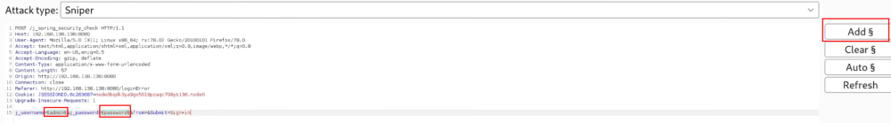

# 1. installation

# 2. usage
- intercept request
- send to intruder
- select the username and press add
- select the password and press add

- switch to pitchfork which is good for credential stuffing (it's one to one)
- cluster bomb is every user with every password

# 3. tips
- changes when bruteforcing is subtle, must pay attention
- ctrl+u can encode with URL, shift+ctrl+u can decode with URL
- 