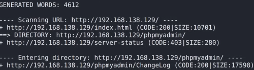
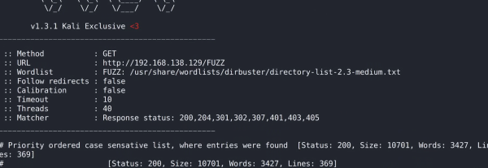

# 1. dirbuster
2. dirbust

3. gobuster
## • installation:
sudo apt install gobuster

## • usage: gobuster dir  -u <url string> -w <word list>
## • eg: gobuster dir -u http://192.168.0.63 -w ~/Downloads/dirb/big.txt
# 
4. dirb
## • installation:
sudo apt install dirb

## • usage: dirb <ip>
- eg: dirb ## <http://192.168.138.129>
## 

- once it finds a directory, it goes in and tries to find everything inside so it takes long

# 5. ffuf
## • installation:
sudo apt install ffuf

## • usage: ffuf -w <wordlist>:FUZZ -u <ip>/FUZZ
- eg: ffuf -w /usr/share/wordlists/medium.txt:FUZZ -u ## <http://192.168.138.129/FUZZ>
## 

- only searches 1 level deep, but that makes it quicker
