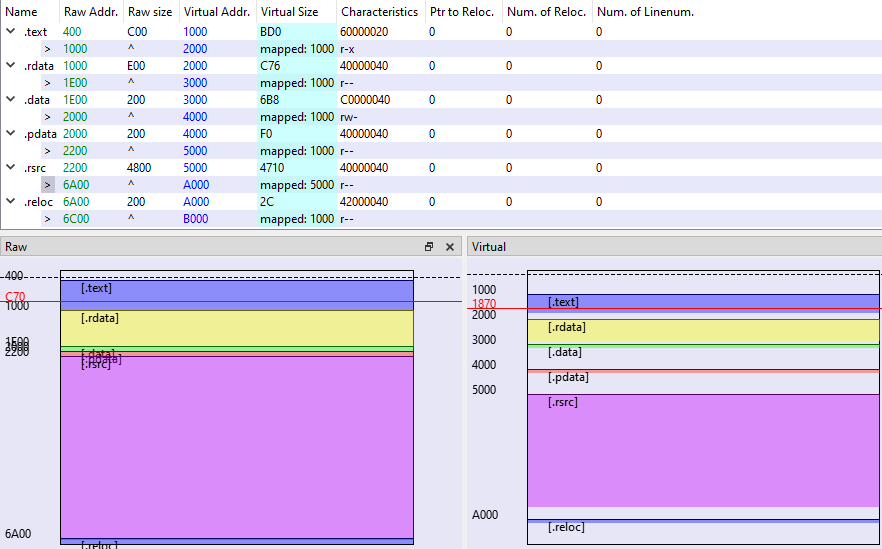

2E 74 65 78 74 00 00 00 D0 0B 00 00 00 10 00 00 00 0C 00 00 00 04 00 00 00 00 00 00 00 00 00 00 00 00 00 00 20 00 00 60 2E 72 64 61 74 61 00 00 76 0C 00 00 00 20 00 00 00 0E 00 00 00 10 00 00 00 00 00 00 00 00 00 00 00 00 00 00 40 00 00 40 2E 64 61 74 61 00 00 00 B8 06 00 00 00 30 00 00 00 02 00 00 00 1E 00 00 00 00 00 00 00 00 00 00 00 00 00 00 40 00 00 C0 2E 70 64 61 74 61 00 00 F0 00 00 00 00 40 00 00 00 02 00 00 00 20 00 00 00 00 00 00 00 00 00 00 00 00 00 00 40 00 00 40 2E 72 73 72 63 00 00 00 10 47 00 00 00 50 00 00 00 48 00 00 00 22 00 00 00 00 00 00 00 00 00 00 00 00 00 00 40 00 00 40 2E 72 65 6C 6F 63 00 00 2C 00 00 00 00 A0 00 00 00 02 00 00 00 6A 00 00 00 00 00 00 00 00 00 00 00 00 00 00 40 00 00 42

