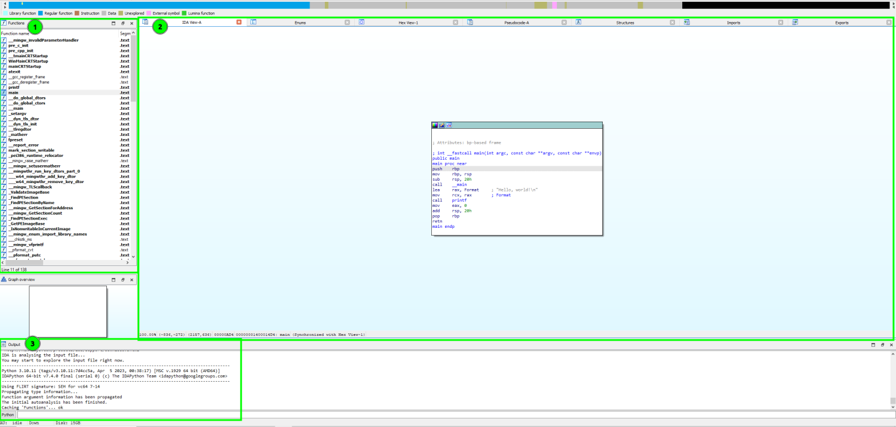
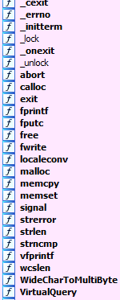
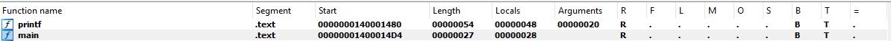
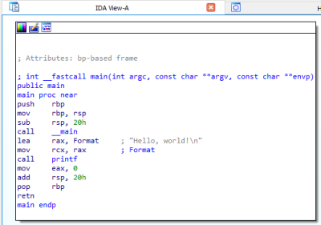
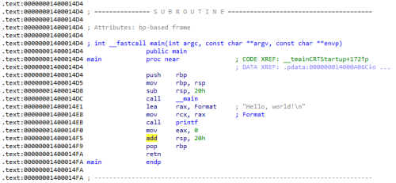
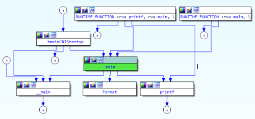
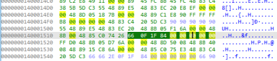
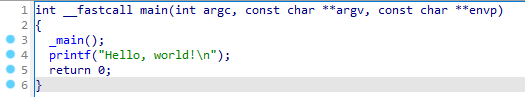
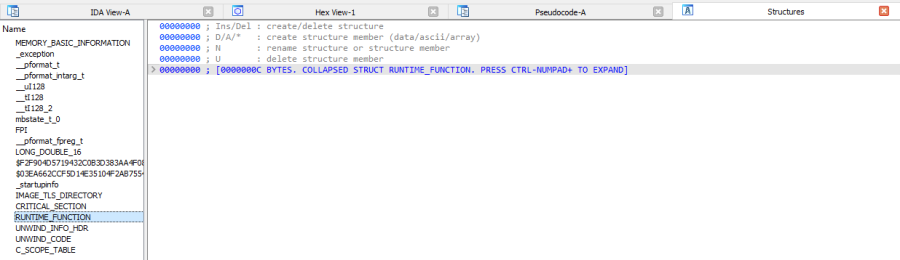
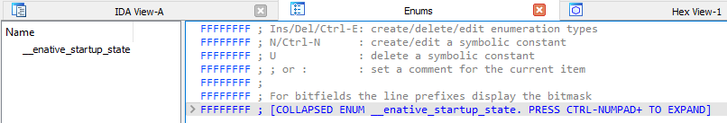

## 1. Functions
functions in the code are shown here

there are a variety of functions that can be found here, even ones I didn't explicitly use in the code

upon expanding the tab or scrolling, you can see there are multiple columns for each function:
- Function name
- Segment
- Start
- Length
- Locals
- Arguments
- R
function returns to the caller
- F
far function
- L
library function
- M
lumina function
- O
outlined code
- S
static function
- B
function used frame pointer (BP)
- T
function has prototype
- =
BP points at the bottom of the stack frame

(1. Functions) further reading:
[1] <https://docs.hex-rays.com/user-guide/user-interface/menu-bar/view/open-subviews#functions-window>

## 2. Subviews
### 2.1. IDA view / Disassembly Window
- graph view

- linear view

- proximity view

*space to change between linear view and graph view, proximity view by right clicking and selecting "proximity browser"*

### 2.2. Hex View Window

you can see the raw bytes of the instructions

### 2.3. Pseudocode Window

*use f5 to view*
you can see the C-like pseudocode

### 2.4. Local Types Window

shows high-level types, such as structs or enums

(2. Subviews) further reading:
[2] <https://docs.hex-rays.com/8.5/getting-started/basic-usage>

## 3. Command line
can use IDC or Python commands

(3. Command line) further reading:
[3] <https://python.docs.hex-rays.com/?_gl=1*16bm4vn*_ga*MTY1Njg1NDc3MS4xNzQxOTI2Njg1*_ga_Y2G1VBHRDB*MTc0MTkyNjY4NS4xLjEuMTc0MTkyODkxMS4wLjAuMA..>

reference:
[1] <https://docs.hex-rays.com/user-guide/user-interface/menu-bar/view/open-subviews#functions-window>
[2] <https://docs.hex-rays.com/8.5/getting-started/basic-usage>
[3] <https://python.docs.hex-rays.com/?_gl=1*16bm4vn*_ga*MTY1Njg1NDc3MS4xNzQxOTI2Njg1*_ga_Y2G1VBHRDB*MTc0MTkyNjY4NS4xLjEuMTc0MTkyODkxMS4wLjAuMA..>